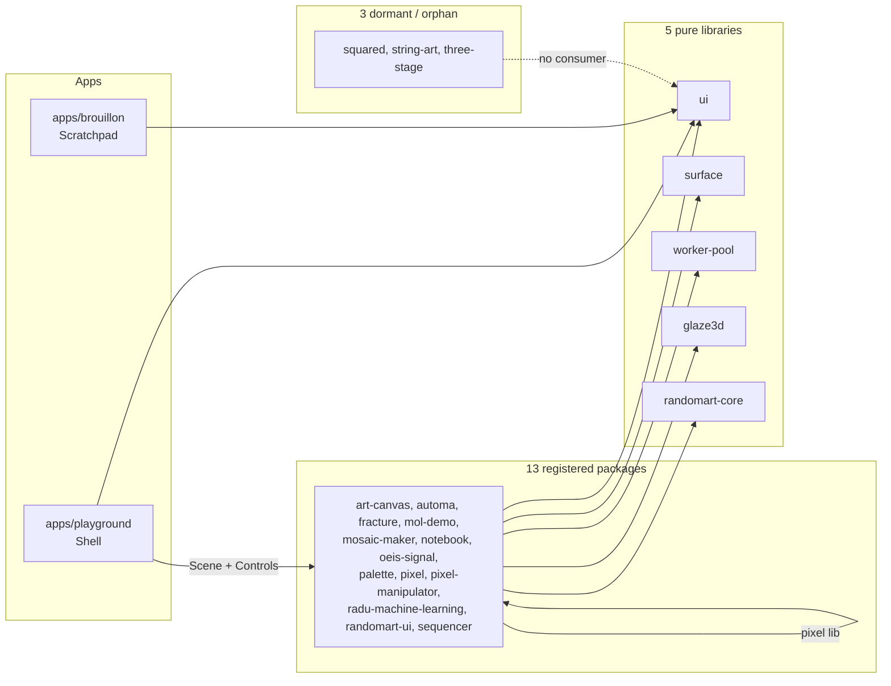
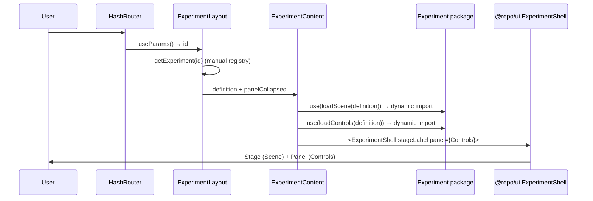

# PG_LAB — Architecture and configuration audit

> **Status:** informational snapshot — no decision is made here and no product code was changed.
> **Snapshot:** working tree at `b1e1ca3` (`squaring controls`, 2026-11-24), audited 2026-11-25. This document also incorporates two follow-up decisions from 2026-11-25: the stale ADR 0001 was deleted, and CI now runs `vp check` without `--fix`.
> **Audience:** the author and external reviewers who do **not** have access to the codebase.
> **Paths:** all paths are relative to the repository root.

---

## Résumé en français

Ce dépôt n'est pas « sale » par accident : il porte les restes d'une **tentative de réorganisation inachevée**. Une architecture cible a été décrite dans la documentation (`README.md`, `PRODUCT.md`, glossaire) puis partiellement implémentée (`8030ab8`, `1a65449`, `baaf7d0`), avant qu'une restauration Git (`40d6fc8`) ne remette le code en arrière — vraisemblablement après la mise à jour des documents mais avant la fin de l'implémentation. L'ADR 0001, artefact de cette tentative, a été supprimé à ta demande. Les trois documents ci-dessus, eux, ne sont pas des restes : ils décrivent l'intention.

Les faits marquants :

- **25 manifests** pnpm (racine + 24 projets) : 2 apps, 21 packages, 1 outil.
- **13 packages « experiments » ont une double identité** : ils sont à la fois des apps autonomes (`index.html`, `src/main.tsx`, script `dev`) **et** des libs consommées par le Shell (`@repo/<pkg>/Scene`, `./Controls`). C'est exactement la dualité que l'intention documentée voulait supprimer.
- **Le registre est écrit à la main** dans `apps/playground/src/experiments.ts` (14 entrées, dont `home`), alors que le README, PRODUCT et le glossaire décrivent un registre dérivé par `import.meta.glob`. `art-canvas` et `fracture` portent en plus leur propre `experiments.ts` : il existe donc plusieurs registres.
- **Scene et Controls sont deux composants sans props**, assemblés par le Shell ; ils communiquent surtout par des stores Zustand globaux. Les `App` standalone existent déjà dans chaque package, mais le Shell ne les importe jamais.
- **Importer l'app entière** (ta préférence) est techniquement simple, mais ce n'est pas un simple changement d'import : le Shell cesse d'être le seul propriétaire du chrome, du Panel, du titre, du thème et de la navigation. Voir **Q2** et **Q3**.
- **« 2 configs Vite et 2 tsconfig »** : il y en a aujourd'hui **19** et **28**. Il faut distinguer l'objectif « 2 *presets* partagés » de l'objectif « 2 *fichiers* au total ». Vite+ impose un fichier de config local par app réellement lancée, et le split réel est aujourd'hui *web / node / web-worker*, pas *app / lib*. Voir **Q5** et **Q6**.
- Une conséquence concrète de l'écart doc/code : le drag & drop `.mol/.sdf` de `mol-demo` existe dans son `App` standalone, mais `stageProps` n'est jamais fourni au registre ; la fonctionnalité est perdue dans le Workbench publié.

**Les cinq questions à trancher en premier** : **Q1** (implémenter l'intention documentée ou la réviser), **Q2** (unité d'intégration : dossier, package ou app entière), **Q3** (contrat d'hôte si l'app entière est importée), **Q4** (définition formelle app vs lib), **Q5/Q6** (cible de configuration). Toutes sont développées dans la [section 9](#9-open-questions-for-reviewers).

Ce document est un état des lieux et une liste de questions, **pas** un plan de migration. Les pistes de découpage en [section 10](#10-candidate-seams--discussion-only) sont volontairement non décidées.

---

## 1. Scope, method, and how to read this document

This is a **read-only audit**. The only file created is this document. Facts were collected from:

- all `package.json`, `pnpm-workspace.yaml`, `vite.config.ts`, and `tsconfig*.json` files;
- source imports in `apps/`, `packages/`, and `tools/`;
- `codex/docs/` (conventions, glossary), `README.md`, `PRODUCT.md`, `DESIGN.md`;
- generated reports (`reports/knip.md`, `reports/*.svg`) and `git log`.

Two kinds of statements are intentionally kept apart:

- **Fact** — observable in the tree at the snapshot commit (paths and exact values given).
- **Question / option** — explicitly marked as such. Nothing here is an agreed decision.

The glossary is used here as a vocabulary reference only; whether it is itself a leftover is part of Q1. In particular: a **Workbench** is the whole environment (Shell + Experiments), an **Experiment** is an openable entry that contributes a **Scene** to the **Stage** and optional **Controls** to the **Panel**, and a **Scratchpad** is the unpublished exploration area. Note that *package*, *workspace*, and *library* have **no glossary entry**, while *app*, *mini-app*, *brouillon*, and *package* are listed as forbidden synonyms for **Experiment** / **Scratchpad**. This is itself an open question (**Q1**, **Q11**).

---

## 2. Key findings at a glance

| # | Finding | Evidence | Why it matters |
|---|---|---|---|
| F1 | The code is the restored pre-implementation state while the intent remains documented in README, PRODUCT, and the glossary | `README.md`, `PRODUCT.md`, `codex/docs/GLOSSARY.md` vs `apps/playground/src/experiments.ts` | A reader can assume the documented target is already implemented; the gap must be made explicit |
| F2 | 13 packages are simultaneously standalone apps and source-export libraries | `packages/*/package.json` (`dev` script + `index.html` + `exports` `./App`, `./Scene`, `./Controls`) | No clear app/lib boundary; duplicated shells, scripts, and configs |
| F3 | The experiment registry is hand-written, and two packages keep a second registry of their own | `apps/playground/src/experiments.ts`; `packages/art-canvas/src/experiments.ts`; `packages/fracture/src/experiments.ts` | Adding or removing an experiment requires editing several files; the documented target calls for one derived registry instead |
| F4 | 19 Vite configs and 28 tsconfig files for 24 projects | glob of `vite.config.ts` / `tsconfig*.json` | Config changes must be replicated; some configs are unreachable from root commands |
| F5 | The root TypeScript solution is broken and does not cover the packages | `tsconfig.json` → `tsconfig.app.json` with `include: ["src"]` while no root `src/` exists; no package projects referenced | `tsc -b` at root reports TS18003; local `tsc -b` scripts do not type-check the workspace solution |
| F6 | Several libraries overlap or are dormant | `surface` / `glaze3d` / local GLSL / `randomart-core`; `oeis-signal` / `sequencer`; `squared`, `string-art`, `three-stage` | Hard to decide where a new feature belongs |
| F7 | Hard-coded package lists live in tooling config | `vite.config.ts` lint overrides (20 React globs + 3 Node globs), `knip.json`, `.jscpd.json`, `tools/new-mini-app` | Any package split must update several lists by hand |
| F8 | Some behavior exists only in standalone `App` files, not in the published Workbench | `mol-demo` `stageProps`, `randomart-ui` `pause()`, theme toggles | The Workbench and the standalone apps are not equivalent products |

---

## 3. Why it looks like a jungle: a short history

The Git history explains most of the apparent mess. The dates and order matter:

| Commit | What happened | Effect on the present tree |
|---|---|---|
| `9a5119a` | Intent documented (README, PRODUCT, glossary) during a reorganization attempt | Experiments as folders with an `import.meta.glob` registry. Still treated as the intended target by the author; the accompanying ADR was an artifact and has since been deleted |
| `8030ab8` | "move workbench experiments into app-owned folders" | Code briefly matched that attempt |
| `1a65449` | "rename Scratchpad and reduce dormant ideas to notes" | In the same attempt: `apps/brouillon` → `apps/scratchpad`, `squared`/`string-art` → notes |
| `baaf7d0` | "split shared Vite config and regenerate tooling" | Current shared `defineAppConfig` pattern introduced |
| `b256cc7` | `Delete Controls.tsx` | Part of the same refactor wave |
| `40d6fc8` | **"Restauration à l'état du commit 964f8b8"** | Reverted the code moves above, **not the documentation**. Experiments returned to packages, the manual registry returned, `apps/scratchpad` became `apps/brouillon` again. The author considers the restore may have landed after the docs were updated but before implementation finished |
| `4d17816` | "clean config" | Current root `vite.config.ts` shape |
| `f9cf440` / `3e773d8`, then `c9d6131` / `dfb71d5` | ui-sdk refactors, then reverts | Components such as `Slider` and `Segmented` oscillated between two implementations |
| `b1e1ca3` | HEAD | Current state |

**Interpretation (not a decision):** the author confirmed that `README.md`, `PRODUCT.md`, and the glossary are **not** leftovers: they state the intended architecture. An accompanying ADR was an artifact of the same attempt and has been deleted (2026-11-25). The restore `40d6fc8` appears to have landed after the docs were written but before the implementation was complete, which is why the code still uses the package + manual-registry model. The open question is therefore not "which document is authoritative" but whether to implement the documented intent or revise it — in particular toward whole-App imports (**Q1**, **Q2**).

---

## 4. Vocabulary used in this document

| Term | Meaning here |
|---|---|
| Workbench | The complete environment: Shell + registered Experiments (`apps/playground` is its published form) |
| Shell | The host: routing, chrome, Stage, Panel, document title, theme toggle |
| Experiment | One openable entry in the Workbench |
| Scene / Stage | The contributed visual component / the Shell region that hosts it |
| Controls / Panel | The optional contributed parameter component / the Shell region that hosts it |
| Scratchpad | Unpublished local exploration area (currently `apps/brouillon`, a forbidden name per the glossary) |
| Package | A pnpm workspace project under `apps/`, `packages/`, or `tools/` — **not** a synonym for Experiment |
| Library | A package consumed as source by another package, with no standalone app shell (target definition, **Q4**) |
| App | A package with its own `index.html`, `main.tsx`, and `dev` script (current de facto definition) |

A reader without the repo should keep in mind that the word *app* is used in two different senses: the glossary forbids it as a synonym for **Experiment**, while the file system currently uses it for packages with a standalone entry point. That ambiguity is part of the naming problem (**Q11**).

---

## 5. Physical inventory

### 5.1 Workspace shape

| Item | Count / value |
|---|---|
| Manifests (`package.json`) | 25 (1 root + 24 projects) |
| Projects | 2 apps + 21 packages + 1 tool |
| Package manager | pnpm 12.8.1, `catalogMode: prefer` |
| Orchestrator | Vite+ 1.6.0 (`vp` CLI); Vite alias `@voidzero-dev/vite-plus-core@1.6.0` |
| Root scripts | `dev: vp dev --host`, `prepare: vp config` (no root `build`, `test`, or `check`) |
| Default project | `defaultPackage: './apps/playground'` in root `vite.config.ts` |
| Deployment | `.github/workflows/deploy.yml`: `vp check` (without `--fix` since 2026-11-25), `vp run playground#build`, upload `apps/playground/dist` |
| Version policy | Every project is `0.0.0`; all are `private: true` except `surface`, `glaze3d`, `worker-pool` |
| Build output | No package has a `build` script or a `dist/` folder; `exports` point directly to `.ts`/`.tsx` sources |

There are **no** alias paths (`paths` / `baseUrl`) in any tsconfig. Resolution relies on pnpm symlinks, package `exports` subpaths, and `resolve.conditions: ['source', 'module', 'browser', 'development|production']` from the root Vite config.

### 5.2 Category A — real apps (2)

| App | Role | Notes |
|---|---|---|
| `apps/playground` | Published Workbench / Shell | `HashRouter`, routes `/` and `/:experiment`; 12 source files; `base` is `/pg_lab/` except on Vercel; script `build: tsc -b && vp build` |
| `apps/brouillon` | Scratchpad / development catalogue | ~2,000 lines of TS including a long `RandomartPipeline` document and a UI component gallery; README is in French and uses a forbidden name |

`apps/brouillon` is **not** just a folder of notes: it is a real app with its own `vite.config.ts`, `tsconfig.json`, and `dist/`. Any decision about the Scratchpad has to account for that code.

### 5.3 Category B — libraries (5 pure + 1 hybrid)

| Library | Nature | Consumers |
|---|---|---|
| `packages/ui` | React 19 + StyleX design system; ~5,700 TS lines, 25+ components, tokens, recipes, decorative visuals | 2 apps + 16 packages + generator template — the hub |
| `packages/surface` | WebGL2 / Canvas2D rendering primitives + React wrappers; ~4,400 TS lines, 9 tests | 6 packages (`art-canvas`, `automa`, `fracture`, `oeis-signal`, `randomart-ui`, `string-art`) |
| `packages/worker-pool` | Web Worker pool abstraction; WebWorker `lib`, Node types | `palette`, `pixel`, `sequencer` |
| `packages/glaze3d` | Homemade math/WebGL2 engine, no React and no `three` dependency | Only `mol-demo` |
| `packages/randomart-core` | DOM-free grammar → GLSL compiler, 15 tests, golden snapshots | Only `randomart-ui` |
| `packages/pixel` | **Hybrid**: image-processing library + worker + React hooks **and** a full documentation app | Library consumed by `pixel-manipulator`; its docs app is a registered Experiment |

### 5.4 Category C — registered Experiments (13 packages, plus `home`)

All of these have `dev`/`lint` scripts, an `index.html`, `src/main.tsx`, and `exports` for `./Scene` and `./Controls` (paths vary: `components/controls/Controls.tsx`, `components/layout/...`, `docs/components/...`).

| Registry id | Package | Size (TS lines) | Notable identity issue |
|---|---|---:|---|
| `art-canvas` | `@repo/art-canvas` | 1,830 | Own second `experiments.ts` |
| `mosaic-maker` | `@repo/mosaic-maker` | 1,151 | — |
| `mol-demo` | `@repo/mol-demo` | 2,508 | Drag & drop only in standalone `App` |
| `automa` | `@repo/automa` | 1,464 | `Controls` wraps its own `ControlPanel` |
| `fracture` | `@repo/fracture` | 2,334 | Own second `experiments.ts`; render-time side effect |
| `radu-machine-learning` | `@repo/radu-machine-learning` | 3,249 | 320 SVG assets |
| `randomart` | `@repo/randomart-ui` | 2,146 | Also contains domain logic, 3 stores, exporters |
| `oeis-signal` | `@repo/oeis-signal` | 447 | `Controls` is a placeholder; standalone `App` does not use Scene/Controls |
| `palette` | `@repo/palette` | 774 | Own worker + dedicated worker tsconfig |
| `pixel` | `@repo/pixel` | 3,683 | Library **and** docs app |
| `pixel-manipulator` | `@repo/pixel-manipulator` | 2,004 | Consumes `pixel` library |
| `notebook` | `@repo/notebook` | 606 | — |
| `sequencer` | `@repo/sequencer` | 2,314 | Worker + Web Audio; module-level `register()` side effect |
| `home` | in-app `apps/playground/src/components/home/Scene.tsx` | — | Only entry that is already a folder in the app |

### 5.5 Category D — dormant or orphan packages (3)

| Package | Actual state |
|---|---|
| `packages/squared` | README describes a full Kirchhoff/Smith-Tutte pipeline; `Scene.tsx` is `return <h1>placeholder</h1>;` (~47 TS lines). Not registered. The documented intent says it should become an idea note. |
| `packages/string-art` | Real `core/` and ~240 TS lines, but no `exports` field and `TRANSFORMS: readonly PixelTransform[] = []`. Not registered. |
| `packages/three-stage` | A genuine standalone React Three Fiber app (~1,000 TS lines, Leva controls); its own README says "not a library". The documented intent says it should become a registered Experiment; it is not registered. Knip flags 7 unused files. |

### 5.6 Category E — tooling (1)

`tools/new-mini-app` is a Node ≥22.18 CLI generator (`bingo` + `zod`) registered as a Vite+ `create` template. It generates a **package** with a `dev` script and a 3-line Vite delegate. Its README references a `packages/specimen` template that does not exist, and the vocabulary ("mini-app") is forbidden by the glossary.

### 5.7 Dependency graph (declared and observed)



Observed facts:

- `ui` is the hub; `surface` is used by 6 packages; `worker-pool` by 3; `glaze3d`, `randomart-core`, and `pixel` each have **one** consumer.
- `squared`, `string-art`, and `three-stage` have **no consumer at all**.
- `pnpm-workspace.yaml` declares a catalog entry for `@repo/randomart-core` that no manifest uses.
- `sequencer/src/modules/fourier/fourier.worker.ts` exists but has no dedicated worker tsconfig (unlike `palette`).
- `reports/knip.md` lists 17 unused files, 2 unused dependencies, 10 unused dev dependencies, 52 unused exports, and 31 unused exported types.

Overlapping concerns worth reviewing: four rendering stacks (`surface`, `glaze3d`, local GLSL in `fracture`/`art-canvas`, `randomart-core/glsl` + post-processing); two sequence engines (`oeis-signal`, `sequencer`); three hand-rolled worker bootstraps; `pixel` vs `pixel-manipulator`; `randomart-ui` vs the frozen documentation copy in `apps/brouillon/RandomartPipeline.tsx`.

---

## 6. How experiments are integrated today

### 6.1 The registry is a hand-written table

`apps/playground/src/experiments.ts` defines the contract and one literal array:

```ts
export interface SceneModule {
    Scene: ComponentType;
    stageProps?: StageProps;
}
export interface ControlsModule {
    Controls: ComponentType;
}
export interface Experiment<TId extends string = string> {
    readonly id: TId;
    readonly label: string;
    readonly panelTitle?: string;
    readonly stageLabel: string;
    readonly tint: ColorNames;
    readonly summary: string;
    readonly isHome?: boolean;
    readonly mark: string;
    readonly loadScene: () => Promise<SceneModule>;
    readonly loadControls?: () => Promise<ControlsModule>;
}

export const EXPERIMENTS = [
    {
        id: 'art-canvas',
        label: 'Art Canvas',
        panelTitle: 'Art Canvas',
        stageLabel: 'art-canvas',
        tint: 'aurora',
        summary: 'GPU shader workshop ...',
        mark: 'art-canvas',
        loadScene: () => import('@repo/art-canvas/Scene'),
        loadControls: () => import('@repo/art-canvas/Controls'),
    },
    // ... 12 more entries, plus home
] as const satisfies readonly Experiment[];
```

Derived helpers in the same file: `ExperimentId`, `ExperimentDefinition`, `experimentCount`, `interactiveExperiments`, `experimentPath()`, `experimentsById`, `getExperiment()`, `experimentOptions`, `loadScene()`, `loadControls()`. Dynamic imports are cached in two `Map`s; failed promises are evicted so an `ErrorBoundary` retry can re-import.

There is **no** `import.meta.glob` anywhere in `apps/playground/src`. The folder-derived registry is part of the documented intent, was implemented briefly in `8030ab8`, then reverted; it is not part of the current design.

### 6.2 Loading flow



### 6.3 The Scene/Controls contract

`ExperimentContent.tsx` is the composition point:

```tsx
const sceneModule = use(loadScene(currentExperiment));
const controlsModule = use(loadControls(currentExperiment));
const { Scene, stageProps } = sceneModule;
const Controls = controlsModule?.Controls;

return (
    <ExperimentShell
        stageLabel={currentExperiment.stageLabel}
        stageProps={stageProps}
        collapsed={panelCollapsed}
        onCollapsedChange={onCollapsedChange}
        panel={Controls ? <ControlPanel title={...}><Controls /></ControlPanel> : undefined}
    >
        <Scene />
    </ExperimentShell>
);
```

Properties of the contract, as implemented:

- `Scene` and `Controls` receive **no props**. There is no application context provided by the playground; only React Router context is available.
- Scene ↔ Controls communication happens through module-level Zustand singletons (e.g. `automa/src/stores/automa/store.ts`, `mosaic-maker/src/stores/mosaic/store.ts` even stores a DOM `RefObject`).
- `stageProps` is declared and forwarded to `ExperimentShell`, but **no loader currently supplies it**.
- `panelTitle` comes from the registry, not from the package.
- The presence of a Panel is decided by `loadControls != null`, before loading.
- Unknown ids silently fall back to `home`, without changing the URL.
- Shell ownership: navigation (`HashRouter`, `/:experiment`), document title, `Suspense`, `ErrorBoundary`, promise cache, theme toggle, collapse state, `ShellWrapper` background, and the responsive Stage/Panel chrome.

Every registered package also has a `./App` export that already composes `ShellWrapper`, `ErrorBoundary`, `ExperimentShell`, `ControlPanel`, `Scene`, and `Controls`. The playground **never imports `./App`**.

### 6.4 What importing the whole App would change

This is the user's stated preference and is discussed as an **option**, not a recommendation. Importing `@repo/<pkg>/App` instead of `/Scene` + `/Controls` would imply:

| Area | Current | With whole-App import |
|---|---|---|
| Shell chrome | Owned once by the playground | Nested `ShellWrapper` + `ExperimentShell` inside the playground's own shell (double background, double resize handle, double `aria-label`) |
| Panel | Added by the host from `loadControls` | Already inside the `App`; `loadControls` and `panelTitle` become redundant or must move into the App |
| Collapse | Controlled by the host header | Inner shell is uncontrolled; the header button would only close an outer, empty panel |
| Props/context | None passed to Scene/Controls | `App` components accept no props today; the host could not inject `stageProps`, collapse state, or theme without a new contract |
| Theme | One toggle in the Shell | Several package `App`s toggle `document.documentElement.style.colorScheme` themselves — competing owners |
| Routing | `HashRouter` + `useParams` in the Shell | Still needed; standalone `App`s do not route |
| Lifecycle | Module-level stores already persist between experiments | Importing `App` also executes import-time effects, e.g. `globalPlaybackStore.pause()` in `randomart-ui`, which never runs today |
| Documentation | The documented intent rejects "packages with a dual app/library identity" | Importing a whole `App` preserves that dual identity; adopt only if the intent is revised |

The upside is real: one composition point per Experiment, no split ownership of the Panel, and standalone apps become identical to the embedded ones. The cost is an explicit host contract and a likely simplification of the Shell. Both are legitimate; the repo cannot have both implicit contracts at once. See **Q2** and **Q3**.

### 6.5 Observed inconsistencies in the Experiments

- `stageProps` is dead in the Workbench; `mol-demo/App.tsx` defines a `.mol/.sdf` drop handler that is therefore unavailable in the published app.
- `automa` and `art-canvas` Controls render their own `ControlPanel`, which the Shell then wraps in a second one.
- `oeis-signal` registers a placeholder `Controls` ("No controls yet."), so an empty Panel opens; its standalone `App` renders `NaturalsDemo` with a custom theme/signal panel instead.
- `randomart` "starts paused" behavior lives in `App.tsx`, so it does not apply in the Workbench.
- `fracture` calls `setPerfExperiment(experimentId)` during render; `sequencer` calls `register()` at module load.
- `experimentCount` is 14 including `home`, while the home grid shows 13 cards.
- `mark` metadata is mostly unused; all cards use the same `GlyphBannerVisual`.
- `apps/playground/src/stores/appStore.tsx` (`shellBackground`) is unused; `ShellWrapper` always uses `lava-flow`.
- `StudioHeader` advertises a `(Cmd+B)` shortcut that is not implemented anywhere.

---

## 7. Configuration landscape

### 7.1 Raw counts

| Item | Count |
|---|---:|
| `vite.config.ts` files | 19 (1 root + 18 local) |
| `tsconfig*.json` files | 28 (3 root + 24 project + 1 extra worker config) |
| `.env` files | 0 |
| ESLint / Prettier / Biome / standalone Vitest / PostCSS / Tailwind / Rollup / tsup configs | 0 |

Lint, format, test, and task configuration are all centralized in Vite+ config blocks; there is no competing linter/formatter setup. That part is healthy.

### 7.2 The root `vite.config.ts` has two jobs

It is a **410-line toolbox**, not a normal app config:

1. **Exported helpers** (lines 1–88): `testConfig`, `sharedViteConfig`, `reactPlugins({ stylex })`, `defineAppConfig({ base, stylex })`. The plugin stack is StyleX unplugin + `react({ compiler: true })` (React Compiler through Oxc).
2. **Workspace config** (lines 294–410): `defaultPackage`, `server`, `test`, `create.templates`, `staged`, `fmt`, `lint` (about 60 base rules, 4 override groups), and `run.tasks` (`knip`, `jscpd`, `madge`, `madgeViewDeps`, `madgeViewCircular`, `audit`).

A comment at the top says every app/package owns a local config that delegates to `defineAppConfig`; that is true for 18 projects and false for the 5 pure libraries and the CLI tool.

`vp check --fix` runs Oxfmt, Oxlint with autofixes, and type-aware/type-checking lint rules from this root config. It uses the workspace root `fmt`/`lint` blocks; local configs cannot override them. The pre-commit hook invokes it via `vp staged`; CI has used `vp check` without `--fix` since 2026-11-25, so CI fails instead of silently rewriting files.

### 7.3 Local Vite configs

Seventeen of the 18 local configs are byte-identical:

```ts
import { defineAppConfig } from '../../vite.config.ts';

export default defineAppConfig();
```

Only `apps/playground/vite.config.ts` adds logic (`process.env.VERCEL` → `base: '/'` else `/pg_lab/`). All 18 have a sibling `index.html` — that is, exactly the packages with a standalone app identity. `stylex: false` is never used; no config defines `build`, SSR, aliases, or explicit target.

### 7.4 TypeScript graph

```text
tsconfig.json  (solution: files: [], references only)
├── tsconfig.app.json   DOM + vite/client + react-jsx + bundler + noEmit
│   ├── apps/playground, apps/brouillon
│   ├── 17 packages (including UI, surface, glaze3d, pixel, …)
│   ├── packages/radu-machine-learning        (+ types: node)
│   └── packages/randomart-ui                 (+ types: node)
└── tsconfig.node.json  ES2023 + types: node, no DOM
    ├── packages/randomart-core
    └── packages/worker-pool                  (lib: ES2023 + WebWorker)

packages/palette/tsconfig.worker.json          extends tsconfig.node, lib ES2022 + WebWorker
tools/new-mini-app/tsconfig.json               standalone, nodenext, no extends
```

Concrete defects:

- `tsconfig.app.json` has `include: ["src"]` but there is no root `src/`. `tsc -b` at root reports **TS18003: No inputs were found**.
- The solution references only the two root bases; **none of the 24 project tsconfigs** is referenced. Root `tsc -b` does not check the packages.
- `tsBuildInfoFile` is inherited from the bases, so all app-family children share one cache file and all node-family children share another.
- The 18 local `vite.config.ts` files belong to no TypeScript program (`tsconfig.node.json` includes only the root config; children include only `src`).
- Node/web mixing: `radu-machine-learning` and `randomart-ui` combine `vite/client` + `node` types; `worker-pool` combines `node` types + `WebWorker` lib; `palette/tsconfig.worker.json` mixes `node` types with an `ES2022` lib while `target` stays `es2023`.
- `sequencer` has a worker file but no worker tsconfig; `glaze3d` declares `@types/node` but its tsconfig never loads Node types.

### 7.5 Other tooling facts

- `knip.json` declares 23 workspace entries + `"."`; it **omits `packages/pixel-manipulator`** and declares a root `src/**` that does not exist.
- `.jscpd.json` ignores `**/vite.config.ts`, so the 17 identical delegates do not appear in the duplication report.
- `vite.config.ts` lint overrides hard-code 20 React paths and 3 Node paths; `knip.json` hard-codes the workspace list; the generator template hard-codes the delegate shape. A package split touches all of them.
- `scripts/build-static.js` still targets `apps/lab` and `src/css/theme.css` (paths that no longer exist) and is not referenced by any script or task. `scripts/dev` uses an old container path.
- Root `engines.node` is `>=22.18.0`, but the Vite+ docs require Node `>=22.22.1` (or `>=24.11.0`) for `vp staged`; CI uses Node 24.
- `server.host: true` at root duplicates `vp dev --host` in package scripts; `defaultPackage` means bare `vp dev` always runs the playground, and the other standalone apps are only reachable via `vp -C <pkg> dev`.

### 7.6 Answer to the "only 2 Vite configs and 2 tsconfigs?" intuition

Short answer: **the intuition is sound, but the count needs a precise target**.

Today there are 19 Vite configs and 28 tsconfig files. Three constraints prevent a literal "2 files" reading:

1. Vite+ discovers workspaces from `pnpm-workspace.yaml` and resolves Vite config from each project directory. A project that can be launched with `vp -C <pkg> dev` needs a local config (or an `index.html` that Vite+ can rank).
2. The root `vite.config.ts` is the workspace config for `vp check`, `vp lint`, `vp fmt`, `vp run`, `vp staged`, and `vp create`. It cannot simply be merged into an app config without losing workspace tooling.
3. The real compiler split is **browser / Node / WebWorker**, not **app / library**. Libraries in this repo are source-exported and consume the same browser compiler options as apps; the Node CLI and the worker files are the actual exceptions.

Two coherent interpretations:

- **Two presets** (recommended framing for discussion): one shared *app* preset and one shared *lib* preset, plus the root workspace config. Local configs then exist only for the 2 real apps, and library packages have none. Total file count ≈ 3–4, single source of truth for each stack.
- **Two files total**: achievable only if there is one launchable app (the playground) and all libraries are consumed as source with no standalone `dev`. This conflicts with keeping `apps/brouillon` as an app and requires the app/lib boundary of **Q4** to be settled first.

The current two root tsconfigs (`app` and `node`) are **not** the app/lib split; they are a DOM/Node split, and they are broken as a solution. Choosing a lib preset means deciding whether libraries need DOM types, JSX, Node types, or worker types — that is **Q6**.

---

## 8. Synthesis: five structural tensions

1. **Ownership of the Experiment.** The documented intent puts Experiments in app-owned folders; the code uses packages as apps + libs; the author prefers importing the whole app. Three boundaries, one registry, and only the middle one is implemented.
2. **Two sources of truth.** The Shell registry, plus local registries in `art-canvas` and `fracture`, plus a documented `import.meta.glob` registry that does not exist in code.
3. **App/lib ambiguity.** 13 packages carry app scaffolding purely so they can be run standalone, while being consumed as libraries. This in turn multiplies configs, scripts, and hard-coded path lists.
4. **Config proliferation without a clear runtime matrix.** 19 Vite configs, 28 tsconfigs, and a broken root solution; browser, Node, and WebWorker concerns are mixed ad hoc.
5. **Documentation/code gap.** The intent is documented in README, PRODUCT, and the glossary; the code is the restored pre-implementation state. Several package READMEs, the generator README, and stale scripts still describe older layouts. Reconciling them is part of the reorganization, not an afterthought (**Q1**).

---

## 9. Open questions for reviewers

These are the questions this document exists to ask. They are deliberately unanswered.

**Q1 — Implement the documented intent, or choose a new target?**
`README.md`, `PRODUCT.md`, and the glossary describe Experiments as app-owned folders with a derived registry and a Scratchpad; the author confirmed these are not leftovers. An accompanying ADR was an artifact and has now been deleted. The restore `40d6fc8` apparently landed after the docs were written but before implementation finished, so the code never caught up. Do we implement that documented target, or revise it — particularly toward whole-App imports (Q2)? If revised, which of the three documents is updated first? *Unlocks:* whether the registry, the Shell boundary, and the Scratchpad move at all.

**Q2 — What is the unit of integration?**
(a) an Experiment folder owned by `apps/playground` (documented intent), (b) a library package contributing `Scene` + `Controls` (current code), or (c) a whole `App` imported by the Shell (author's preference)? What is the strongest argument against your preferred option?

**Q3 — If an `App` is imported wholesale, what is the host contract?**
Who owns the Shell chrome, Panel, collapse state, document title, theme toggle, and routing? Should `App` accept props (`ExperimentShellProps`-like), a context, or neither? How do we avoid two nested `ExperimentShell`s and two Panels? Are the import-time effects (e.g. `pause()`) acceptable?

**Q4 — What formally defines an app versus a library?**
Candidate criteria: has `index.html` / `main.tsx` / `dev` script / `App` export / standalone `vite.config.ts`; versus exports source subpaths only, declares `peerDependencies`, is built by its consumer. Which criteria are mandatory, and is `apps/brouillon` an app or a Scratchpad area?

**Q5 — Is the config target "2 presets" or "2 files"?**
Can we accept 1 root workspace config + 1 app preset + 1 lib preset + one tiny local config per real app? Or is a literal two-file target required? What should happen to `defaultPackage` and to `vp -C <pkg> dev` for the other apps?

**Q6 — How many TypeScript environments do we actually need?**
Browser + React + StyleX, pure TS library, Node CLI, Web Worker, and tests are all present. Can these be expressed by two configs, or is a base + per-runtime set of thin projects more honest? What replaces the broken root `tsconfig.app.json` (`TS18003`)?

**Q7 — Which packages should be split, if any?**
Candidates and why: `pixel` (library + docs app), `art-canvas` and `fracture` (duplicate registries), `randomart-ui` (domain logic + UI), `glaze3d` (single consumer), `oeis-signal` vs `sequencer` (sequence engines), `surface` vs local GLSL stacks (rendering). Which split has the best value/risk ratio, and which should be left alone?

**Q8 — What happens to dormant packages and the Scratchpad?**
`squared` is a placeholder, `string-art` is dormant, `three-stage` is a standalone app with no consumer, and `apps/brouillon` contains ~2,000 lines of real code. Archive, convert to notes, register, or leave frozen? The glossary currently forbids the name `brouillon`.

**Q9 — How should the registry be produced?**
Hand-written table (current), folder manifests + `import.meta.glob` (documented intent, briefly implemented in `8030ab8`), or generated metadata? How do we guarantee a single source of truth, especially for `art-canvas` and `fracture`, which keep their own lists? What happens to unknown ids in URLs?

**Q10 — What is the safest migration order?**
Start from a clean definition of the target (Q1–Q4) and move seam by seam, or is there value in reviving parts of `8030ab8` / `1a65449` / `baaf7d0`, now known to be an unfinished implementation of the documented intent? How do we keep CI (`vp check`, `vp run playground#build`) green during the transition, and should each seam be its own PR?

**Q11 — Do we update the vocabulary first?**
`package`, `workspace`, and `library` are absent from the glossary; `app` is a forbidden synonym of `Experiment` yet used for standalone packages; `brouillon` is a forbidden synonym of `Scratchpad`. The glossary is treated as valid intent, but it lacks entries for *package*, *workspace*, and *library*. Any rename must follow conventions §2.1.8/§2.1.9 and update the glossary in the same change. Do we settle naming before or after the structural split?

**Q12 — Who owns the hard-coded tooling lists after a split?**
`vite.config.ts` lint overrides, `knip.json`, `.jscpd.json`, `tools/new-mini-app`, `scripts/build-static.js`, and package READMEs all encode today's package layout. Should they be derived from `pnpm-workspace.yaml`, or is an explicit checklist acceptable?

---

## 10. Candidate seams — discussion only

These are **possible** cut lines, not a plan. Each is a place where the current structure already suggests a boundary.

| Current package(s) | Candidate seam | What it would unlock | Risk / open question |
|---|---|---|---|
| `packages/pixel` | Split `processor/` + worker + React hooks (library) from `src/docs/` (Experiment) | Library no longer carries a `dev` script or `App`/`Scene`/`Controls` exports | Convention §12.3 requires `src/assets` + `?url` rather than `public/` + `fetch()` for assets used by consumers |
| `packages/art-canvas`, `packages/fracture` | Remove either the standalone `experiments.ts` or the Shell registry | One registry instead of two | Their standalone mode currently depends on that local registry |
| `packages/randomart-ui` | Keep `randomart-core` as the pure compiler; decide whether UI widgets, exporters, and post-processing stay in one package | Clearer core/shell boundary per conventions §1.2 | Single consumer; splitting may add indirection without benefit |
| `packages/mol-demo`, `palette`, `oeis-signal`, `three-stage` | Decide a single owner for theme toggles, backgrounds, and `App`-level `stageProps` | Workbench and standalone apps behave the same | Depends on Q3 (host contract) |
| `packages/glaze3d` | Keep as shared engine or fold into `mol-demo` | Removes a one-consumer "library" | The engine is tested independently (11 tests) |
| `packages/oeis-signal` vs `sequencer` | Compare the two sequence engines before adding features | Avoids two implementations of the same concern | Different rendering targets (Canvas vs Web Audio + Worker) |
| `packages/worker-pool` consumers | Share the worker bootstrap pattern | Removes three hand-rolled `new Worker(new URL(...))` variants | Each worker has different lifecycle needs |
| 13 Experiment packages | Extract `Scene` + `Controls` into app-owned folders, or extract a shared Experiment contract package | One app/lib boundary, fewer local configs | Conflicts with Q2 if the whole-App option wins; a shared `@repo/lab` framework was once rejected and should be re-evaluated |

---

## 11. Evidence and how to verify

Commands (read-only) used to collect the facts above:

```sh
git show --stat 8030ab8      # folder-based experiments implemented
git show --stat 40d6fc8      # restoration that reverted the implementation
git log --oneline -35        # refactor / revert chronology
vp run audit                 # knip + madge + jscpd reports (writes reports/)
vp check                     # CI gate: format + lint + type-aware checks (not run during this audit)
```

Key files to read, in order:

1. `README.md`, `PRODUCT.md`, `codex/docs/GLOSSARY.md` — the documented intent; the former ADR was deleted in 2026-11-25.
2. `apps/playground/src/experiments.ts` — the registry that actually exists.
3. `apps/playground/src/components/ExperimentContent.tsx` — the Scene/Controls contract.
4. `packages/ui/src/components/ExperimentShell.tsx` — the host chrome contract.
5. `vite.config.ts` — shared app preset, lint policy, and workspace tasks.
6. `pnpm-workspace.yaml` + `tsconfig.json` / `tsconfig.app.json` / `tsconfig.node.json` — workspace and compiler topology.
7. `codex/docs/GLOSSARY.md` and `codex/docs/conventions/` — naming and dependency rules (§2.1.8, §2.1.9, §2.7, §12.3, §14).

Note: `vp run audit` and `vp check` were **not** run as part of this audit; the tooling figures come from the existing `reports/` files and static inspection.

---

## 12. What this document deliberately does not decide

- Whether the documented target should be implemented as written or revised (Q1, Q2); the stale ADR has been deleted.
- Whether Experiments should be folders, packages, or whole apps.
- Whether to add, remove, or rename any package.
- How many config files the final architecture should contain.
- A migration sequence, a timeline, or an assignment of work.

Those are the decisions requested from the reviewers through the questions in [section 9](#9-open-questions-for-reviewers).
