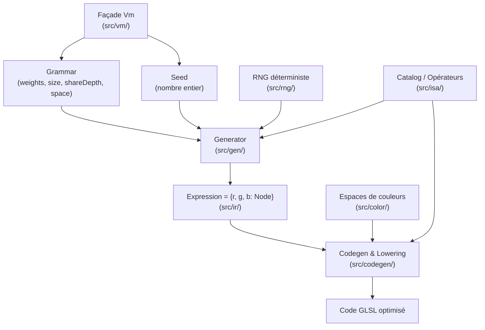

# Analyse : RandomArt VM & UI

## TL;DR

**Le concept de VM est solide et cohérent** — il sépare la synthèse procédurale pure (la VM) de la restitution visuelle et du contrôle utilisateur (l'UI).

Ce document décrit en termes simples et clairs l'architecture, le flux de données et le rôle de chaque composant du projet.

---

## 1. C'est quoi RandomArt, vraiment ?

L'application transforme un couple `(règles, graine)` en image procédurale animée :

```
(grammar, seed)  →  Expression (IR)  →  GLSL  →  GPU / Image
```

Étape par étape :

| Étape               | Ce qui se passe                                                                         |
| ------------------- | --------------------------------------------------------------------------------------- |
| **Grammar**         | Définit les probabilités d'opérateurs, la complexité, le partage et l'espace de couleur |
| **Seed**            | Un simple nombre entier qui pilote tout le déterminisme pseudo-aléatoire                |
| **Generate**        | Un algorithme récursif synthétise un arbre mathématique respectant la grammaire         |
| **Expression (IR)** | La formule est stockée sous forme d'arbre immuable (`Node` pour chaque canal R, G, B)   |
| **Codegen**         | L'arbre est compilé en shader fragment GLSL ES 3.00 optimisé                            |
| **Canvas**          | Le GPU exécute le shader pixel par pixel en temps réel (avec animation `u_phase`)       |

Le même `(grammar, seed)` produit **toujours** la même image au pixel près. C'est l'invariant fondamental.

---

## 2. Pourquoi parler de "VM" ?

Le parallèle avec une machine virtuelle ou un compilateur classique est direct :

```
CPU classique    →   opcode + opérandes  →  registres / mémoire  →  résultat
RandomArt VM     →   opérateur + params  →  arbre IR             →  pixel GLSL
```

- **ISA** (Instruction Set Architecture) : le catalogue des opérateurs mathématiques (`x`, `y`, `sin`, `mul`, `div`, `warp`, `select`...).
- **IR** (Intermediate Representation) : l'arbre `Node` / `Expression`. C'est le programme compilé neutre, sérialisable et inspectable.
- **Grammar** : le synthétiseur de programme — il gouverne quelles instructions sont sélectionnables et selon quel profil de taille.
- **Codegen / Lowering** : le backend du compilateur qui transforme le graphe (DAG) en code GLSL avec mise en commun des sous-expressions (`shared` variables) et injection des fonctions mathématiques / espaces de couleur.
- **VM** : la façade orchestratrice de haut niveau (`createGrammar`, `generate`, `compile`, `render`).

---

## 3. Architecture détaillée de `randomart-vm`



### Rôle des modules (`randomart-vm`)

- **`src/spec/`** — Les contrats fondamentaux : erreurs typées (`GenError`, `IrError`, `CodegenError`), limites strictes (taille max GLSL, profondeur max).
- **`src/shared/`** — Types `Brand<T>` pour garantir la sécurité à la compilation (un `Seed` ne peut pas être confondu avec un simple `number`), assertions et guards.
- **`src/rng/`** — Générateur pseudo-aléatoire pur et déterministe (PCG32) + utilitaire `randomSeed()`.
- **`src/isa/`** — Le jeu d'instructions (catalogue d'opérateurs) complet :
    - _Terminaux_ : `x`, `y`, `const` (avec modulation temporelle optionnelle pour l'animation).
    - _Arithmétique_ : `add`, `sub`, `mul`, `div`, `neg`, `abs`, `sqr`, `min`, `max`, `mix`.
    - _Trigonométrie_ : `sin`, `cos`.
    - _Logique_ : `gt`, `select`.
    - _Transformation_ : `warp` (déformation non-linéaire avec repliement d'espace `ra_fold2`).
- **`src/color/`** — Conversion du triplet brut `[-1, 1]³` vers le format d'affichage sRGB final :
    - Supporte `sRGB`, `OKLCH`, `OKLab`, `HSL`.
- **`src/grammar/`** — Configuration de la synthèse :
    - Poids des opérateurs, contraintes de taille (`tiny`, `small`, `medium`, `large`), profondeur de partage (`shareDepth`).
    - Espace quantifié (`drawGrammar`, `grammarKey`).
    - Presets d'usine (`grammarRegistry`) et reconnaissance de presets (`presetOf`).
    - Invariants de sécurité (`isLastTerminal`, `isLastNonTerminal` pour garantir une grammaire toujours fonctionnelle).
- **`src/ir/`** — Représentation intermédiaire :
    - Nœuds immuables (`Node`) et triplets de canaux (`Expression`).
    - Sérialisation/désérialisation canonique JSON.
    - Inspecteur textuel (`formatFormula`) pour lire les formules générées en notation fonctionnelle.
- **`src/gen/`** — L'algorithme de synthèse récursive avec contrôle de budget de complexité et de partage de structure.
- **`src/codegen/`** — Traducteur GLSL :
    - Lowering en DAG (évite de recalculer plusieurs fois les mêmes sous-expressions via variables temporaires `v0`, `v1`...).
    - Gestion des contextes de coordonnées pour les opérateurs comme `warp`.
    - Émission du contrat GLSL (`vUv`, `v_p`, `u_phase`, `o_color`).
- **`src/vm/`** — Point d'entrée utilisateur unifié (`Vm` et singleton `vm`).

---

## 4. Concepts clés à retenir

### Le `shareDepth` (corrélation chromatique)

Génère l'arbre pour les 3 canaux R, G et B :

- **`shareDepth = 0`** : R, G et B sont générés indépendamment. Les formes et textures de chaque couleur sont différentes → image très multicolore et éclatée.
- **`shareDepth` modéré (ex: 2)** : Le tronc commun de la formule est partagé entre R, G et B jusqu'à la profondeur indiquée, puis les branches divergent → cohérence structurelle et harmonie des teintes.
- **`shareDepth >= maxDepth` (mono)** : Les 3 canaux partagent exactement le même arbre → l'image devient monochrome (ou modulée uniquement par l'espace de couleur).

### Les espaces de couleurs

L'arbre mathématique calcule 3 valeurs `(r, g, b)` dans `[-1, 1]`. L'espace de couleur dicte la manière dont ces 3 nombres sont interprétés :

- **sRGB** : direct (chaque canal contrôle l'intensité RGB).
- **OKLCH** : `r` = clarté (L), `g` = chromaticité/saturation (C), `b` = teinte/hue (h). Produit des dégradés perceptuellement uniformes et très riches.
- **OKLab** : clarté + axes vert/rouge et bleu/jaune.
- **HSL** : teinte, saturation, luminosité classique.

---

## 5. Ce que fait `randomart-ui`

`randomart-ui` est la vitrine interactive construite au-dessus de `@repo/randomart-vm` et `@repo/glaze` :

1. **Mode Toy** (découverte / jeu) :
    - Génération instantanée en 1 clic ("New image").
    - Historique des créations récentes avec retour immédiat sur une graine antérieure.
    - Lecture / Pause de l'animation.
    - Export PNG de l'image en pleine résolution.

2. **Mode Lab** (atelier d'exploration) :
    - **Lecture & Rythme** : Contrôle du temps, remise à zéro, réglage fin de la durée de la boucle d'animation.
    - **Atelier de Grammaire** : Choix des presets ou grammaire sur mesure, réglage de la graine, sélecteur d'espace de couleur, curseurs de pondération par famille d'opérateurs, profils de taille et curseur de partage `shareDepth`.
    - **Inspecteur de Formule** : Affichage de la formule mathématique générée par canal (avec mise en page claire).
    - **Affichage des Erreurs** : Remontée visuelle immédiate des erreurs d'actions ou de compilation de shader.

3. **Moteur de Rendu (`RandomArtCanvas`)** :
    - Optimisation _lazy-rendering_ (`needsRender`) : si l'image est statique ou en pause, aucun calcul GPU n'est gaspillé.
    - Préservation du buffer WebGL pour permettre l'export direct vers image PNG.
