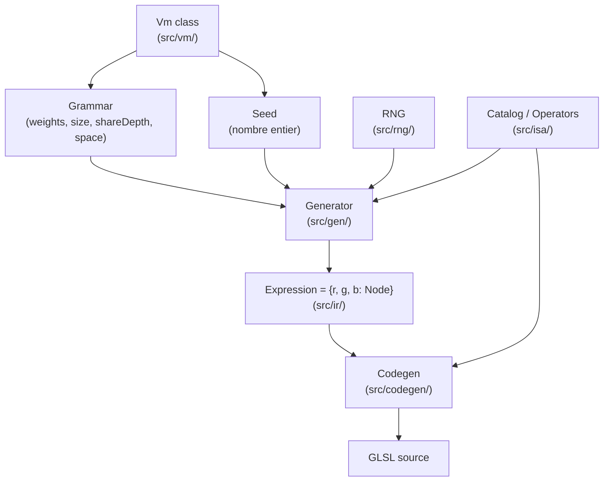

# Analyse : RandomArt VM

## TL;DR

**Le concept de VM est solide et cohérent** — il mérite d'être gardé. Mais la progression a outrepassé la compréhension. L'objectif de ce document : te donner le modèle mental pour comprendre ce que tu as construit.

---

## 1. C'est quoi RandomArt, vraiment ?

L'app originale fait une chose précise :

```
(grammar, seed)  →  Expression  →  GLSL  →  Image
```

Étape par étape :

| Étape               | Ce qui se passe                                                               |
| ------------------- | ----------------------------------------------------------------------------- |
| **Grammar**         | Tu définis les règles : quels opérateurs utiliser, quelle complexité          |
| **Generate**        | Un algorithme aléatoire mais _déterministe_ fabrique une formule mathématique |
| **Expression (IR)** | La formule est stockée sous forme d'arbre (`Node`)                            |
| **Codegen**         | L'arbre est traduit en code GLSL (shader GPU)                                 |
| **Canvas**          | Le GPU exécute le shader pixel par pixel → image                              |

Le même `(grammar, seed)` donne **toujours** la même image. C'est la règle fondamentale.

---

## 2. Pourquoi parler de "VM" ?

L'idée est bonne et pas gratuite. Voilà pourquoi ça tient :

```
CPU classique    →   opcode + opérandes  →  registres/mémoire  →  résultat
RandomArt VM     →   opérateur + params  →  arbre (IR)         →  pixel GLSL
```

- **ISA** (Instruction Set Architecture) : la liste des opérateurs (`sin`, `mul`, `x`, `y`...). C'est le jeu d'instructions.
- **IR** (Intermediate Representation) : l'arbre `Node/Expression`. C'est le "programme compilé".
- **Grammar** : c'est le "compilateur source → IR" — il contrôle quelles instructions sont disponibles et avec quelle fréquence.
- **Codegen** : traduit l'IR en GLSL. C'est le "backend" de ta VM.
- **VM** : l'orchestrateur qui connecte tout.

> [!NOTE]
> Une vraie VM (comme la JVM) exécute des instructions à la volée. Ici, la VM _génère_ un programme statique (l'arbre) puis le _compile_ vers un backend (GLSL). C'est plus proche d'un **compilateur ahead-of-time** que d'une VM interprétée — mais le terme reste valide pour désigner l'ensemble du pipeline.

---

## 3. Architecture actuelle de `randomart-vm`



### Les modules en 2 phrases chacun

**`src/spec/`** — Les règles du jeu. Définit les erreurs (`GenError`, `IrError`...) et les constantes limites (taille max du source GLSL, etc.).

**`src/shared/`** — Utilitaires TypeScript. Types `Brand<T>` (pour rendre les types nominaux, donc impossibles à confondre), `asserts`, `guards`.

**`src/rng/`** — Le générateur de nombres aléatoires. Prend un `seed`, produit des nombres déterministes. C'est la seule source d'aléatoire du système.

**`src/isa/`** — Le catalogue d'opérateurs. Chaque opérateur (`sin`, `mul`, `x`...) a : un nombre d'entrées (`arity`), des paramètres (`params`), et une fonction qui génère du GLSL (`glsl()`).

**`src/grammar/`** — La configuration d'une génération. Poids sur les opérateurs + profil de taille + shareDepth. La grammar est immuable (frozen) et identifiée par un hash.

**`src/ir/`** — La représentation interne du programme. Un `Node` = `{ op, params, inputs[] }`. Une `Expression` = `{ r: Node, g: Node, b: Node }` (les 3 canaux RGB). Tout est immuable.

**`src/gen/`** — L'algorithme de génération. Parcourt récursivement en dessinant des opérateurs au hasard (via le RNG), en respectant le budget (profondeur/taille) et le `shareDepth` (partage de structure entre canaux RGB).

**`src/codegen/`** — Traduit l'arbre IR en code GLSL. Gère le partage de variables (`shared` policy) et émet le contrat GLSL standard (`vUv`, `v_p`, `o_color`, etc.).

**`src/vm/`** — La façade publique. La classe `Vm` orchestre tout : `createGrammar()`, `generate()`, `compile()`, `render()`.

---

## 4. Ce que fait `shareDepth` (concept clé)

C'est la chose la plus subtile. Imagine que tu génères l'arbre pour le rouge (R), le vert (G) et le bleu (B).

- Si `shareDepth = 0` : R, G, B sont **complètement indépendants** → image colorée, chaotique
- Si `shareDepth` est élevé : R, G, B **partagent la même structure** jusqu'à une certaine profondeur → image plus cohérente, souvent plus "grise" ou harmonieuse

```
shareDepth = 0 :
  R = sin(mul(x, y))
  G = add(x, const)    ← différent !
  B = cos(x)           ← différent !

shareDepth = 2 :
  R = sin(mul(x, y))
  G = sin(mul(x, y))   ← même structure partagée
  B = sin(mul(x, y))   ← même structure partagée
```

---

## 5. Ce que `randomart-ui` apporte

C'est l'interface React qui utilise `randomart-vm`. Elle :

- Stocke l'état (`seed`, `shareDepth`, `size`, `weights`) dans un store Zustand
- Appelle `vm.render()` pour obtenir le GLSL
- Passe le GLSL au composant `GpuCanvas` (de la lib `@repo/glaze`) qui l'exécute sur le GPU

```
vmStore (Zustand) → vm.render() → GLSL → GpuCanvas → image
```

---

## 6. Ce qui est bien ✅

- **Le concept est cohérent** : grammar → IR → codegen est une vraie architecture pipeline.
- **L'isolation est respectée** : `randomart-vm` n'a aucune dépendance React/DOM — c'est pur TypeScript.
- **Les types sont bons** : le type `Brand<T>` pour `Node`, `Expression`, `Grammar`, `Seed` empêche les erreurs de confusion.
- **La structure des fichiers est claire** : chaque dossier a une responsabilité unique.
- **Les tests de base existent** et couvrent les cas fondamentaux (déterminisme, sérialisation, contrat GLSL).
